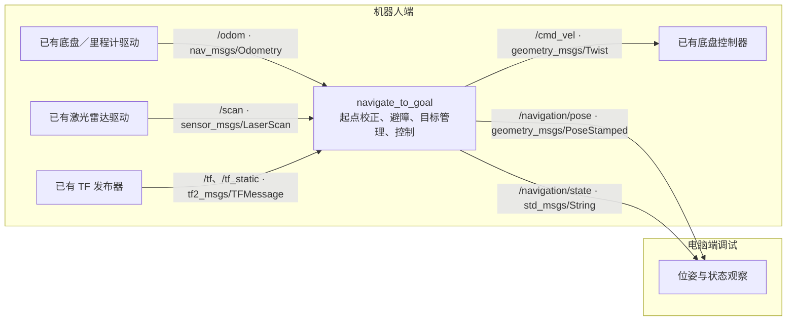

# Lab 4：ROS 2 顺序目标点导航与激光避障

[English](README.md) | [中文](README_中文.md)

组员：**Ding Jiang、Tongning Zhang**

这是基于已在 Lab 3 跑通的机器人接口编写的 Lab 4 初版：沿用 `/scan`、`base_link`、默认 `Twist` 类型的 `/cmd_vel`、20 Hz 控制频率，以及 0.15 m/s 和 0.8 rad/s 的速度上限；新增里程计起点校正、顺序目标点管理、停车计时和激光避障。Lab 4 不需要相机、颜色识别或 Lab 3 的自定义消息包。

当前开发环境是 macOS，没有 ROS 2。这一版尚未经过 ROS 2 构建、真实传感器联调或实机验证。下文给出算法验证和机器人端测试步骤；纯 Python 仿真不能证明实机通过实验。

## 1. 文件与运行结构

```text
lab4_ws/
├── src/team_navigate_to_goal/
│   ├── team_navigate_to_goal/
│   │   ├── navigate_to_goal.py     # 唯一的实验 ROS 2 节点
│   │   ├── geometry.py             # 起点坐标系与刚体变换
│   │   ├── scan.py                 # 激光有效性、可通行距离、墙面方向
│   │   ├── navigation.py           # 目标点与导航状态机
│   │   └── watchdog.py             # 时间戳和接收超时检查
│   ├── config/lab4.yaml            # 启动参数
│   ├── config/wayPoints.txt        # 老师提供的三个目标坐标
│   ├── launch/navigate_to_goal.launch.py
│   └── test/                      # 无 ROS 算法测试与理想二维仿真
├── README.md
└── README_中文.md
```

`team_navigate_to_goal` 是 ROS 包名，`navigate_to_goal` 是节点名和可执行程序名。其余 Python 文件是节点内部调用的算法模块，不是额外的 ROS 节点。

| 方向 | 话题 | 消息类型 | 用途 |
|---|---|---|---|
| 输入 | `/odom` | `nav_msgs/msg/Odometry` | 当前位置与朝向 |
| 输入 | `/scan` | `sensor_msgs/msg/LaserScan` | 360° 水平激光扫描 |
| 输入 | `/tf`、`/tf_static` | `tf2_msgs/msg/TFMessage` | 将激光和里程计底盘 frame 对齐到 `base_link` |
| 输出 | `/cmd_vel` | `geometry_msgs/msg/Twist` | 底盘线速度与角速度 |
| 输出 | `/navigation/pose` | `geometry_msgs/msg/PoseStamped` | 本次实验起点坐标系中的位姿 |
| 输出 | `/navigation/state` | `std_msgs/msg/String` | JSON 格式的状态、目标序号和说明 |

如底盘实际要求 `TwistStamped`，将 `cmd_vel_stamped` 改为 `true`。默认 `false` 与 Lab 3 一致。传感器订阅沿用适用于传感器的 QoS。

下面是计算图示意；驱动节点的实际名字以机器人现有 bringup 为准。建议把导航节点与驱动都运行在机器人端，电脑用于查看话题和记录实验。



## 2. 目标点与导航行为

程序读取 `wayPoints.txt` 中的坐标，按照文件顺序到点，不自动返回起点。

| 顺序 | 目标坐标（m） | 程序到点半径 | 手册满分半径 | 停车时间 |
|---|---|---|---|---|
| 1 | `(1.5, 0)` | 0.08 m | 0.10 m | 10 s |
| 2 | `(1.5, 1.4)` | 0.12 m | 0.15 m | 10 s |
| 3 | `(0, 1.4)` | 0.16 m | 0.20 m | 10 s |

程序使用稍紧的到点半径预留误差空间，但真实地面位置仍受里程计漂移影响。到点时没有指定最终朝向要求。

| 状态 | 行为 |
|---|---|
| `GO_TO_GOAL` | 用距离和朝向误差控制运动；朝向误差大时先原地转向 |
| `FOLLOW_WALL` | 避开前方障碍，沿选择的一侧绕行；目标方向重新畅通且距离目标有足够进展后恢复前往目标 |
| `HOLD` | 进入到点半径后持续发送零速度，保持 10 秒；离开半径或传感器中断会重新计时 |
| `DONE` | 三个目标全部完成后保持零速度 |
| `BLOCKED` | 一次绕障超过 `avoidance_timeout` 等不可继续条件下保持零速度 |

节点还会发布 `WAITING_FOR_DATA`、`FAULT` 和关闭时的 `STOPPED` 状态。里程计或激光未到、过期、时间戳异常、必要 TF 缺失时停车；前方或绕墙所需扇区未知、障碍进入机器人膨胀半径时也停车，原因写在状态的 `status` 字段中。暂时的数据故障恢复后可继续导航；`BLOCKED`、时钟回退等故障需要处理原因，并把机器人放回实验起点重新启动。

避障是面向有绕行空间的箱状障碍的反应式方案：根据激光点估计局部墙面方向，保持侧向距离，尝试重新朝向当前目标。它没有建立全局地图，也不是对任意迷宫都保证成功的路径规划器。狭窄通道、凹形障碍、目标被障碍覆盖或绕行空间不足都可能无法完成；这类情况需要根据实测修改策略。

## 3. 起点坐标系与 TF

每次启动后，第一帧有效的底盘位姿 `(x₀, y₀, θ₀)` 定义实验原点和 `+x` 朝向。`StartFrame` 使用：

```text
dx = x - x₀,  dy = y - y₀
x_lab =  cos(θ₀) × dx + sin(θ₀) × dy
y_lab = -sin(θ₀) × dx + cos(θ₀) × dy
θ_lab = wrap_to_[-π, π](θ - θ₀)
```

该平面变换与老师 `Rotation_Script.py` 的起点平移和逆旋转在数学上等价，并对角度做跨 ±π 归一化。它不重置原始 `/odom`，不消除里程计累计误差，也不发布新的 TF。`/navigation/pose` 默认标记为 `lab_start`，用于观察转换结果。

启动节点前，应先把机器人放在实验 `(0, 0)`，车头对准规定的 `+x` 方向。中途重启会重新定义原点，不能把机器人留在半途中直接当作续跑。

激光点按照扫描时间戳，通过真实的雷达到底盘 TF 变换到 `base_frame`。`/odom` 的 `child_frame_id` 为 `base_footprint` 时，还需存在到配置的 `base_link` 的 TF；程序会补上这个变换后统一计算位置。不要为消除 TF 报错而随意发布单位变换。

## 4. 在机器人端构建与启动

沿用 Lab 3 已成功使用的 Ubuntu、ROS 2 和机器人 bringup。下例假设把本工作空间复制到机器人上的 `~/lab4_ws`，使用 ROS 2 Humble；如果实际使用 Jazzy，则替换发行版名。

```bash
source /opt/ros/humble/setup.bash
cd ~/lab4_ws
rosdep update
rosdep install --from-paths src --ignore-src -r -y
colcon build --symlink-install
source install/setup.bash
```

如这台机器人尚未初始化 `rosdep`，先按系统配置执行 `sudo rosdep init`。每个新终端都需要加载 ROS 2 和本工作空间环境；跨电脑查看话题时沿用 Lab 3 已验证的 `ROS_DOMAIN_ID` 和网络配置。

先按原来的方式启动底盘、里程计、激光雷达及底盘 TF。Lab 4 的 launch 只启动导航节点，不启动驱动或相机。停止 Lab 3 跟随节点和 teleop，避免它们同时向 `/cmd_vel` 发布命令。

```bash
ros2 topic list -t
ros2 topic echo /odom --once
ros2 topic echo /scan --once
ros2 topic info /cmd_vel --verbose
# 将 ACTUAL_LASER_FRAME 替换为 /scan 的 header.frame_id。
ros2 run tf2_ros tf2_echo base_link ACTUAL_LASER_FRAME
```

核对后，把机器人摆在起点，再启动：

```bash
source /opt/ros/humble/setup.bash
source ~/lab4_ws/install/setup.bash
ros2 launch team_navigate_to_goal navigate_to_goal.launch.py
```

launch 通过已安装的包目录找到默认 YAML 和目标文件，可从任意当前目录启动。需要调参时建议明确指定源文件：

```bash
ros2 launch team_navigate_to_goal navigate_to_goal.launch.py \
  params_file:="$HOME/lab4_ws/src/team_navigate_to_goal/config/lab4.yaml"
```

参数在启动时读取，设为只读。修改 YAML 后重新启动节点；修改默认安装配置后可重新构建以确保安装目录更新。`waypoints_file` 留空表示使用安装目录中的 `config/wayPoints.txt`；自定义目标文件请填写绝对路径，目标数须与 `goal_tolerances` 数量一致。实机保持 `use_sim_time:=false`；只有发布 `/clock` 的 ROS 仿真才使用 `use_sim_time:=true`。

另一个终端可查看：

```bash
ros2 topic echo /navigation/pose
ros2 topic echo /navigation/state
ros2 topic echo /cmd_vel
```

`/navigation/state` 内 `goal_index` 从 0 开始，三个目标完成后为 3；文字 `status` 中的目标编号从 1 开始。

## 5. 第一轮实机调试

先测量机器人尺寸。`robot_radius: 0.22` 是初始估计，不是已确认型号的尺寸；应改为从 `base_frame` 原点到机器人水平外缘最远处的距离。程序用圆形包络计算碰撞余量，过小会低估车体尺寸，过大则可能过早停车或无法通过本可通过的空间。

| 参数 | 初始值 | 调整依据 |
|---|---:|---|
| `robot_radius` | 0.22 m | 实测底盘 frame 到最远水平外缘的距离 |
| `safety_margin` | 0.04 m | 圆形包络外的额外余量 |
| `wall_distance` | 0.40 m | 绕障时底盘原点到障碍表面的期望距离；应大于半径加余量 |
| `obstacle_trigger_distance` | 0.65 m | 沿当前方向前进、膨胀包络接触障碍前的可行距离阈值 |
| `wall_follow_speed` | 0.10 m/s | 绕障最高前进速度 |
| `preferred_turn` | `auto` | 自动选择较空的一侧；也可设 `left` 或 `right` |
| `linear_kp` / `angular_kp` | 0.5 / 1.5 | 距离与朝向比例增益，沿用 Lab 3 初始值 |
| `max_forward_speed` / `max_angular_speed` | 0.15 m/s / 0.8 rad/s | 沿用 Lab 3 限速 |
| `pose_timeout` / `scan_timeout` | 0.5 s / 0.5 s | 数据来源时间与本机接收时间的失效阈值 |

建议按以下顺序验证，每轮重新摆回起点再启动：

1. **确认位姿和方向。** 起点的调试位姿应接近 `(0, 0, 0)`；低速测试前进时 `x` 增加、向左转时 yaw 增加，实测行驶距离与里程计变化大致一致。
2. **无障碍跑三个目标。** 观察到点半径、10 秒停车和最终 `DONE`。用地面标记测量真实停车误差，同时记录总时间。
3. **单个箱子避障。** 留出足够绕行空间，检查左右转向、侧向间距、绕过拐角后恢复前往目标。根据实际尺寸调整 `robot_radius`、`wall_distance` 和触发距离，再调整增益。
4. **旋转箱子和临时障碍。** 测试不同箱体角度，确认激光能稳定检测到障碍；然后在真实实验路线测试固定及临时障碍，记录是否碰撞、每点误差与耗时。

调试时确保底盘具有命令超时停车功能，并能及时人工停车。程序正常退出会发送零速度；断网、强制杀进程或硬件故障时，仍需要底盘本身的超时保护。

## 6. 常见停车原因

| 现象或状态说明 | 检查内容 |
|---|---|
| `WAITING_FOR_DATA` / 数据过期 | 驱动是否发布；`header.stamp` 是否为零、重复、过旧或超前；跨主机时钟是否同步；实机是否误开 `use_sim_time` |
| TF 报错 | `/scan` 的 frame、配置的 `base_frame`、`/odom` 的 child frame 是否正确；是否有对应时间戳的完整 TF 链 |
| `Too few valid laser rays` / `sector is unknown` | 无效值比例、前方盲区、所需侧向扇区是否被遮挡；是否为 360° 水平雷达 |
| `obstacle inside robot radius + safety margin` | 周围是否有近障；半径是否过大；雷达是否扫到自身，或 TF 偏移是否错误 |
| `BLOCKED` / 绕障超时 | 路线是否有空间、目标是否被遮挡、绕行距离和增益是否合适；排除原因后回起点重新启动 |
| 有速度输出但不动 | 底盘订阅类型是否与 `Twist` / `TwistStamped` 配置一致；是否有其他速度发布者或底盘故障 |

激光有效性规则：`+inf` 表示本次射线无回波，可作为有效的空闲方向；`NaN`、零、负值和超过 `range_max` 的有限值视为未知。有限的正值即使小于 `range_min` 也保留为近障，避免漏掉危险的近距离读数。整体有效比例足够仍不意味着每个方向都可用，前方或绕墙扇区的连续盲区也会触发停车。

## 7. 本地算法验证

以下命令在 `lab4_ws` 目录运行，只使用 Python 标准库，不需要 ROS，也不会发布机器人速度：

```bash
python3 -m unittest discover -s src/team_navigate_to_goal/test -p 'test_*.py' -v
python3 src/team_navigate_to_goal/test/simulation.py
```

安装了 pytest 时也可以运行：

```bash
python3 -m pytest -q src/team_navigate_to_goal/test
```

`simulation.py` 对理想二维机器人模拟空场地，以及不同旋转角度的固定箱子和随后插入的箱子，输出到点误差、停车时间、总时间、最小间距和完成状态。它没有轮胎打滑、里程计漂移、扫描噪声和通信延迟，也不是 Gazebo 或 ROS 集成测试。实际布局和传感器表现仍需上机验证。

本地已通过 **23 项 unittest 测试**，其中导航测试 9 项、传感器与几何相关测试 14 项。理想二维仿真中的无障碍场景、箱子旋转 0° / 30° / 60° / 90° 的场景，以及改变到点半径后的 60° 回归场景，均在 150 秒内完成三个目标、各停车 10 秒且未发生碰撞。这些结果只验证相应的合成场景，不代表实机成绩。

在 ROS 2 环境完成构建后再运行包测试：

```bash
cd ~/lab4_ws
colcon test --packages-select team_navigate_to_goal
colcon test-result --verbose
```

包内自动测试主要覆盖独立算法；通过这些测试不等于验证了 ROS 消息、QoS、TF 的实际运行或底盘运动。

另有无需机器人的 ROS 2 集成检查。在 Ubuntu 上完成构建并加载环境后分别运行普通和带时间戳的速度接口检查：

```bash
source /opt/ros/humble/setup.bash
cd ~/lab4_ws
source install/setup.bash
python3 src/team_navigate_to_goal/test/ros_smoke.py
python3 src/team_navigate_to_goal/test/ros_smoke.py --stamped
```

脚本用合成 `/odom`、`/scan` 和 TF 检查实际 ROS 节点接口、坐标变换、近障停车，以及雷达和里程计分别中断时的停车行为。每次运行把数据及 TF 话题隔离到新建的 UUID 命名空间，不向机器人的常规 `/cmd_vel` 发布消息。该脚本需单独运行，不属于 `colcon test`；上述两种模式目前均尚未执行，待 ROS 2 环境验证。
